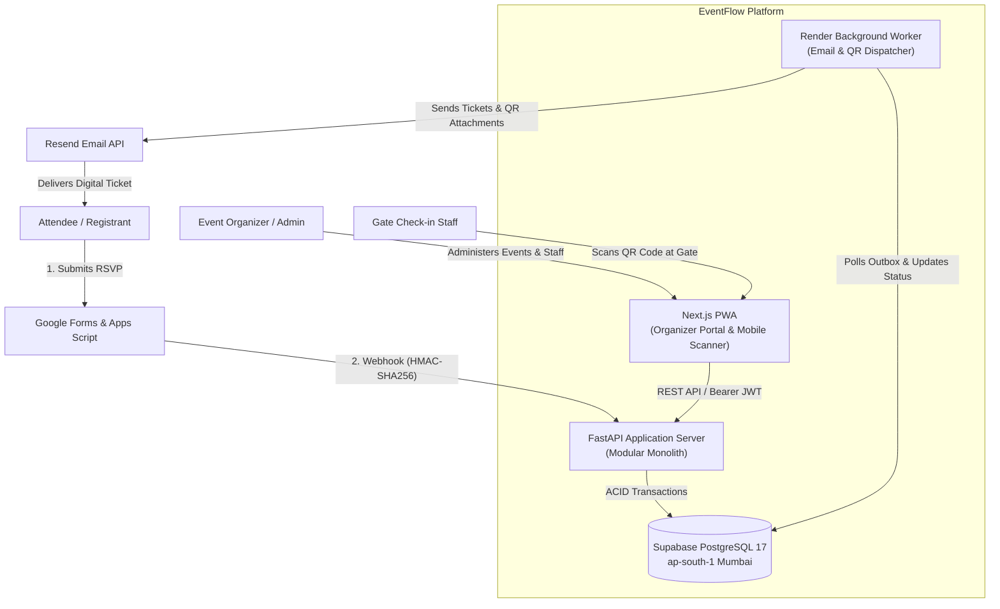
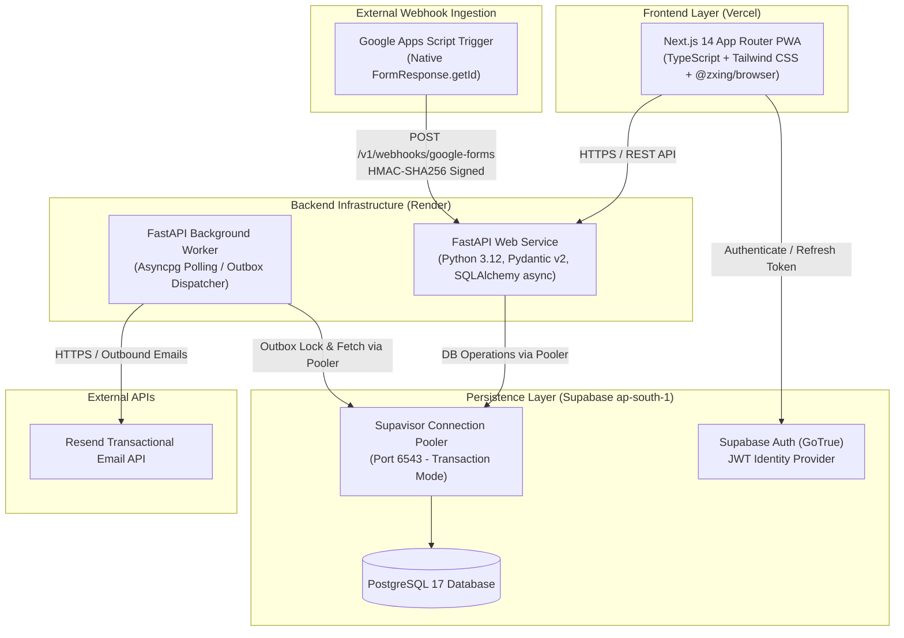
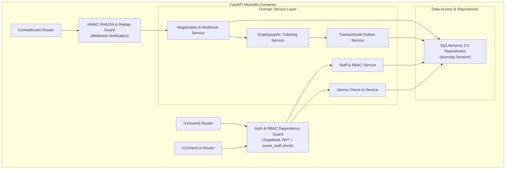
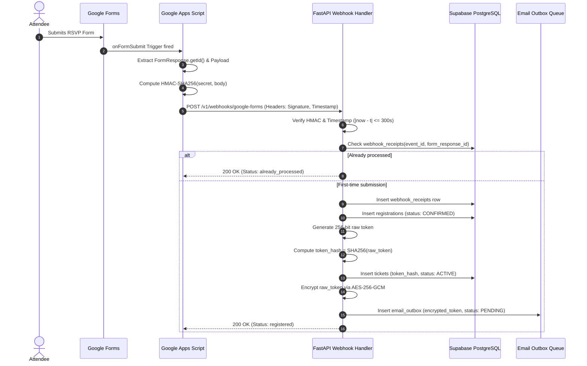
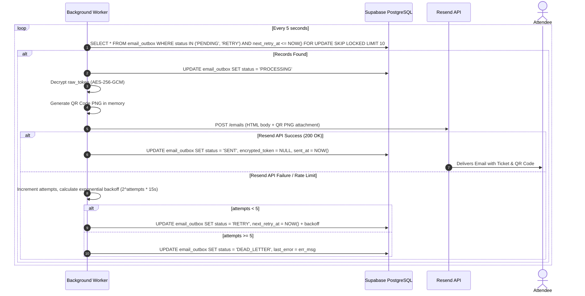
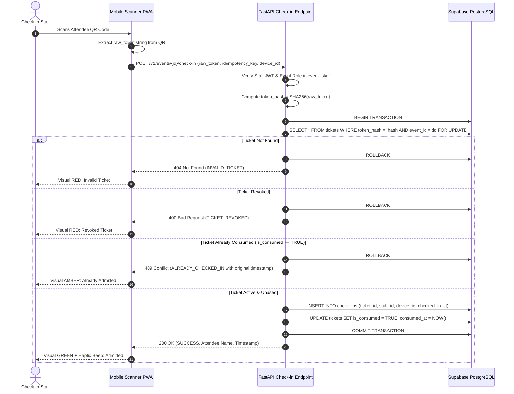

# EventFlow — System Architecture & Product Discovery Specification

**Phase**: Phase 1: Product Discovery & System Architecture  
**Document**: Architecture Design Document  
**Version**: 1.0.0  
**Status**: APPROVED  
**Project**: EventFlow — Multi-Event RSVP, Digital Ticketing, and QR-Based Attendance Management Platform

---

## 1. Repository Inspection & Baseline Audit

### 1.1 Existing Assets and Findings
- **Workspace State**: Newly initialized repository containing governance and phase specification documents (`Master.md`, `phase 1.md` through `phase 5.md`, `desgin.md`, `review.md`).
- **Database Provisioning**: Supabase PostgreSQL 17 cluster provisioned in `ap-south-1` (Mumbai, India, Asia) with project reference `jkchyjghuaiyulxqzobl`.
- **Environment**: Initialized `.env`, `.env.example`, and `.gitignore` configuring connection pooler (`aws-1-ap-south-1.pooler.supabase.com:6543`), direct migration host (`db.jkchyjghuaiyulxqzobl.supabase.co:5432`), and Supabase Auth credentials.
- **Missing Components Identified**: Application source trees (`frontend/`, `backend/`, `automation/`, `infrastructure/`), schema migrations, package manifests, and CI/CD pipelines.
- **Architectural Guardrails**: Modular monolith approach mandated; strict prohibition against premature microservice fragmentation; zero raw PII in QR tokens; database-level atomic check-in enforcement.

---

## 2. Requirement Engineering

### 2.1 Functional Requirements

1. **FR-01: Multi-Event Management**:
   - Organizers can create, configure, update, and archive events with metadata (name, slug, venue, start/end dates, timezone, capacity limits, registration status).
   - Event settings maintain unique webhook secrets and cryptographic signing keys.
2. **FR-02: Google Forms Registration Ingestion**:
   - Ingest RSVP submissions through HTTP POST webhooks triggered by Google Apps Script.
   - Require HMAC-SHA256 signature verification in `X-Webhook-Signature`.
   - Prevent webhook replay using timestamp tolerance windows (5-minute maximum drift).
   - Enforce idempotent ingestion using native Google Form response ID (`FormResponse.getId()`).
3. **FR-03: Registration Processing**:
   - Parse and validate incoming attendee details (name, email, phone, custom metadata) via strict Pydantic schemas.
   - Enforce one attendee per confirmed RSVP submission in initial release.
   - Prevent duplicate confirmed registrations per event for identical email addresses.
4. **FR-04: Cryptographically Secure Unique Ticket Generation**:
   - For every confirmed registration, generate a 256-bit entropy token using `secrets.token_urlsafe(32)`.
   - Store only `SHA-256(raw_token)` in the database `tickets` table.
   - Prohibit storing raw tokens or attendee PII inside the database or QR payload.
5. **FR-05: Asynchronous Email Delivery & Retry**:
   - Enqueue outgoing ticket emails into a transactional outbox (`email_outbox`).
   - Encrypt raw ticket tokens in the outbox using authenticated AES-256-GCM.
   - Background worker renders QR code PNG dynamically and dispatches HTML email via Resend API.
   - Implement exponential backoff retry (up to 5 attempts) with dead-letter queue classification.
   - Purge encrypted token payload upon confirmed delivery.
6. **FR-06: Staff Authentication**:
   - Gate access via Supabase Auth (GoTrue) using email/password or magic links.
   - Issue short-lived JWT access tokens and secure refresh cookies.
7. **FR-07: Event-Scoped Role-Based Access Control (RBAC)**:
   - Restrict user permissions per event via the `event_staff` mapping.
   - Prevent cross-event data leakage (strict tenant isolation).
8. **FR-08: Mobile QR Scanning Client**:
   - Mobile-first Progressive Web App (PWA) operating camera scanning via `@zxing/browser`.
   - Real-time client-side feedback (Valid, Already Used, Revoked, Invalid).
   - Fail-closed behavior: reject admission on network or validation errors.
9. **FR-09: Atomic Ticket Check-In**:
   - Validate and consume tickets in an isolated database transaction with row-level locks (`SELECT ... FOR UPDATE`).
   - Enforce single consumption via database unique constraints on `check_ins(ticket_id)`.
   - Support client idempotency keys to safely tolerate network retry duplicates.
10. **FR-10: Attendance & Analytics Reporting**:
    - Aggregate real-time metrics: total registrations, checked-in count, check-in velocity over time, gate distribution.
    - Export attendance lists for organizers with check-in timestamps.
11. **FR-11: Ticket Revocation & Re-Issuance**:
    - Event Admins can revoke active tickets, immediately invalidating physical QR codes.
    - Support re-issuing a new ticket (generating a fresh cryptographic token) and triggering a new email dispatch.
12. **FR-12: Immutable Audit Logging**:
    - Append-only recording of administrative actions (staff invitations, ticket revocations, manual check-in overrides, export actions) in `audit_logs`.

### 2.2 Non-Functional Requirements

- **NFR-01: Security**:
  - OWASP Top 10 compliance. Zero plaintext credentials or raw QR tokens stored in persistent databases.
  - Constant-time HMAC comparison for webhooks. Rate-limiting on public check-in and auth endpoints.
  - HTTPS/TLS 1.3 in transit.
- **NFR-02: Reliability**:
  - Exactly-once ticket consumption guarantee at the database layer.
  - Webhook delivery resilience: idempotent 200 OK responses on retry.
- **NFR-03: Availability**:
  - Backend API target uptime 99.9%. Check-in scanning endpoint operational with p99 latency < 250ms under peak arrival bursts.
- **NFR-04: Maintainability**:
  - Clean architecture with domain boundaries. 100% type annotations in Python (Pydantic v2 / MyPy) and TypeScript (Strict Mode).
  - Version-controlled database migrations via Alembic.
- **NFR-05: Performance**:
  - Check-in endpoint handles up to 50 concurrent requests per event gate with sub-100ms database transaction execution.
  - Connection pooling via Supabase Supavisor to prevent connection thrashing.
- **NFR-06: Scalability**:
  - Stateless backend web services horizontally scale on Render.
  - Asynchronous background worker decoupled via transactional database queue.
- **NFR-07: Observability**:
  - Structured JSON logging (correlation ID, event ID, staff ID). Zero PII or JWT secrets emitted in logs.
  - Health check endpoint `/v1/health` providing database and background worker heartbeat.
- **NFR-08: Privacy**:
  - Minimal PII collection. Attendees can request data erasure (subject to regulatory audit retention).
- **NFR-09: Data Consistency**:
  - Strong transactional consistency for registrations, ticket issuance, and check-ins via PostgreSQL ACID transactions.

---

## 3. User Roles & Permission Matrix

| Role | Scope | Key Capabilities | Prohibitions |
| :--- | :--- | :--- | :--- |
| **Platform Owner** | Global | Full system administration, organization management, global audit review. | Cannot bypass database encryption keys. |
| **Event Owner** | Event | Full control over owned events, webhook configuration, staff role assignment, ticket revocation, CSV exports. | Cannot access other events without explicit assignment. |
| **Event Admin** | Event | Manage registrations, resend tickets, view reports, assign Check-in Staff. | Cannot delete event or remove Event Owner. |
| **Check-in Staff** | Event | Scan QR codes (`POST /v1/events/{id}/check-in`), register scanner devices. | Cannot view full attendee lists, PII, email logs, or webhook secrets. |
| **Read-only Viewer** | Event | View aggregated dashboard reports, attendance graphs, and statistics. | Cannot scan tickets, mutate registrations, or access raw data. |

### 3.1 Detailed Permission Matrix

| Operation | Platform Owner | Event Owner | Event Admin | Check-in Staff | Read-only Viewer |
| :--- | :---: | :---: | :---: | :---: | :---: |
| `POST /v1/events` (Create Event) | Yes | Yes | No | No | No |
| `PATCH /v1/events/{id}` (Update Event) | Yes | Yes | Yes | No | No |
| `DELETE /v1/events/{id}` (Delete Event) | Yes | Yes | No | No | No |
| `POST /v1/events/{id}/staff` (Manage Staff) | Yes | Yes | Staff only | No | No |
| `GET /v1/events/{id}/registrations` | Yes | Yes | Yes | No | No |
| `POST /v1/events/{id}/tickets/{id}/revoke`| Yes | Yes | Yes | No | No |
| `POST /v1/events/{id}/tickets/{id}/resend`| Yes | Yes | Yes | No | No |
| `POST /v1/events/{id}/check-in` | Yes | Yes | Yes | Yes | No |
| `GET /v1/events/{id}/attendance` (Metrics)| Yes | Yes | Yes | Gate stats | Yes |
| `GET /v1/events/{id}/audit-logs` | Yes | Yes | Yes | No | No |

---

## 4. High-Level Architecture Design

### 4.1 System Context Diagram (C4 Level 1)



### 4.2 Container Diagram (C4 Level 2)



### 4.3 Component Diagram (FastAPI Modular Monolith)



### 4.4 End-to-End Sequence Diagrams

#### 4.4.1 Registration Ingestion & Ticket Creation Sequence



#### 4.4.2 Asynchronous Email Dispatch & Retry Sequence



#### 4.4.3 Atomic Check-in Sequence



---

## 5. Domain Design & Bounded Contexts

EventFlow defines 9 explicit bounded contexts:

### 5.1 Event Management Domain
- **Entities**: `Event`
- **Responsibilities**: Event lifecycle management, venue metadata, capacity tracking, public registration toggle, webhook secret management.
- **Business Rules**:
  - Event slugs must be globally unique and URL-safe.
  - An event cannot accept registrations if `status != 'ACTIVE'` or `capacity_reached == TRUE`.
- **Failure Modes**: Duplicate slug creation, expired event registration attempts.

### 5.2 Staff Management Domain
- **Entities**: `EventStaff`
- **Responsibilities**: Staff role mapping, privilege assignment, gate permission verification.
- **Business Rules**:
  - A user cannot be assigned multiple conflicting roles for the same event.
  - Event Owner cannot be removed while active registrations exist.
- **Failure Modes**: Unauthorized staff elevation, cross-event impersonation.

### 5.3 Registration Domain
- **Entities**: `Registration`
- **Responsibilities**: Attendee profile persistence, form field normalization, registration confirmation, cancellation.
- **Business Rules**:
  - Only one active registration per email per event.
  - Status must strictly follow lifecycle: `PENDING -> CONFIRMED -> CANCELLED`.
- **Failure Modes**: Duplicate attendee email submission, malformed attendee data.

### 5.4 Ticketing Domain
- **Entities**: `Ticket`
- **Responsibilities**: Cryptographic token generation, SHA-256 hash persistence, revocation management.
- **Business Rules**:
  - Exactly one ticket generated per confirmed registration.
  - Raw tokens are never persisted in the `tickets` table.
- **Failure Modes**: Entropy exhaustion (prevented by `secrets.token_urlsafe`), hash collision (probability < $10^{-77}$).

### 5.5 Check-in Domain
- **Entities**: `CheckIn`
- **Responsibilities**: Atomic ticket verification, gate admission logging, duplicate scan rejection.
- **Business Rules**:
  - Strict atomic single consumption: `ticket_id` must be unique in `check_ins`.
  - Scans must fail closed when backend is unreachable or transaction conflicts occur.
- **Failure Modes**: Concurrent double-scan race condition, scanner network timeout.

### 5.6 Email Delivery Domain
- **Entities**: `EmailOutbox`
- **Responsibilities**: Transactional outbox queuing, encrypted token storage, QR code rendering, Resend API communication, retry backoff.
- **Business Rules**:
  - Encrypted token must be wiped immediately upon confirmed delivery.
  - Maximum 5 retry attempts before transition to `DEAD_LETTER`.
- **Failure Modes**: Resend API outage, invalid recipient email bounce.

### 5.7 Webhook Integration Domain
- **Entities**: `WebhookReceipt`
- **Responsibilities**: Inbound HTTP webhook verification, HMAC validation, replay filtering, idempotent dispatch.
- **Business Rules**:
  - Must use Google Form response ID (`FormResponse.getId()`) as the immutable idempotency key.
  - Timestamps must fall within 300 seconds of server time.
- **Failure Modes**: Forged HMAC signature, clock drift rejection, replayed receipt.

### 5.8 Reporting Domain
- **Entities**: `AttendanceSummary`, `GateVelocityMetric` (Read-only projections)
- **Responsibilities**: Real-time event statistics, gate check-in throughput, exportable attendance sheets.
- **Business Rules**:
  - Aggregate metrics must not expose attendee PII to staff roles without export permissions.
- **Failure Modes**: High query load during live event check-in bursts (mitigated via read-optimized summary queries and database indexes).

### 5.9 Audit Logging Domain
- **Entities**: `AuditLog`
- **Responsibilities**: Immutable append-only record of security-critical mutations.
- **Business Rules**:
  - Rows are append-only; update and delete operations are rejected at the database rule/permission level.
- **Failure Modes**: Log storage growth (managed via archival retention policy).

---

## 6. Domain State Machines & Lifecycle Transitions

### 6.1 Registration State Machine
```
[Start] --> PENDING --> CONFIRMED --> CANCELLED --> [End]
               \                      ^
                \                     |
                 +--------------------+
```
- **Allowed Transitions**:
  - `PENDING -> CONFIRMED`: Webhook validated and ticket created.
  - `CONFIRMED -> CANCELLED`: Organizer or attendee cancels registration.
  - `PENDING -> CANCELLED`: Ingestion validation fails or expired before confirmation.
- **Forbidden Transitions**:
  - `CANCELLED -> CONFIRMED`: Cancelled registrations cannot be revived; a new submission is required.
  - `CONFIRMED -> PENDING`: State cannot regress.

### 6.2 Ticket State Machine
```
[Start] --> ACTIVE --> REVOKED --> [End]
```
- **Allowed Transitions**:
  - `ACTIVE -> REVOKED`: Admin revokes ticket due to cancellation, reissue, or security compromise.
- **Forbidden Transitions**:
  - `REVOKED -> ACTIVE`: Once revoked, a ticket can never be un-revoked. A new ticket must be issued.
- **Consumption Dimension**: `is_consumed` is a monotonic boolean flag transitioning once from `FALSE -> TRUE`.

### 6.3 Email Outbox State Machine
```
[Start] --> PENDING --> PROCESSING --> SENT --> [End]
                              |          
                              v          
                            RETRY --> PROCESSING
                              |
                              +----(Attempts >= 5)----> DEAD_LETTER --> [End]
```
- **Allowed Transitions**:
  - `PENDING -> PROCESSING`: Worker claims batch.
  - `PROCESSING -> SENT`: Resend accepts message (200 OK). Payload encrypted token wiped.
  - `PROCESSING -> RETRY`: Resend returns 429 or 5xx. Retry count incremented.
  - `RETRY -> PROCESSING`: `next_retry_at` timestamp reached.
  - `PROCESSING -> DEAD_LETTER`: Max retry threshold (5) exceeded.
- **Forbidden Transitions**:
  - `SENT -> PENDING` or `SENT -> RETRY`: Terminal success state cannot be reprocessed.
  - `DEAD_LETTER -> SENT`: Cannot bypass terminal failure without manual admin intervention.

### 6.4 Check-in State Machine
```
[Start] --> NOT_CHECKED_IN --> CHECKED_IN --> [End]
```
- **Allowed Transitions**:
  - `NOT_CHECKED_IN -> CHECKED_IN`: Verified active ticket scanned at gate and committed in database.
- **Forbidden Transitions**:
  - `CHECKED_IN -> NOT_CHECKED_IN`: Attendance cannot be undone via scanner API. Manual administrative override requires an explicit audit log entry.

---

## 7. Data Flow & Idempotency Pipeline

### 7.1 Webhook Ingestion Flow
1. **Google Apps Script**:
   - `onFormSubmit(e)` event retrieves `e.response.getId()` — a globally unique, non-recyclable alphanumeric ID generated by Google.
   - Script constructs JSON payload:
     ```json
     {
       "event_id": "8c59f07a-...",
       "form_response_id": "2_ABaOnud...",
       "submitted_at": "2026-11-27T08:15:30Z",
       "attendee": {
         "name": "Jane Doe",
         "email": "jane@example.com",
         "phone": "+919876543210"
       }
     }
     ```
   - Script computes `signature = Hex(HMAC-SHA256(event_secret, json_string))`.
   - Sends HTTP POST to FastAPI `/v1/webhooks/google-forms` with headers `X-Webhook-Signature` and `X-Webhook-Timestamp`.
2. **FastAPI Webhook Gate**:
   - Compares current time with `X-Webhook-Timestamp`. If `abs(now - timestamp) > 300s`, drop request.
   - Recomputes HMAC-SHA256 over raw request bytes and validates against `X-Webhook-Signature` using `hmac.compare_digest`.
   - Opens PostgreSQL transaction:
     - Attempts insert into `webhook_receipts (event_id, form_response_id)`.
     - On unique constraint violation (`ON CONFLICT DO NOTHING`), reads existing registration and returns `200 OK` (idempotent no-op).
     - On fresh insert, creates `registrations` row and generates ticket.

---

## 8. Monorepo Project Structure & Folder Responsibilities

```
EventFlow/
├── backend/                       # Python FastAPI Modular Monolith
│   ├── app/
│   │   ├── api/                   # API routers versioned (/v1)
│   │   │   ├── v1/
│   │   │   │   ├── events.py
│   │   │   │   ├── staff.py
│   │   │   │   ├── registrations.py
│   │   │   │   ├── tickets.py
│   │   │   │   ├── checkin.py
│   │   │   │   ├── webhooks.py
│   │   │   │   ├── reporting.py
│   │   │   │   └── health.py
│   │   ├── core/                  # Cross-cutting foundational modules
│   │   │   ├── config.py          # Pydantic Settings & env configuration
│   │   │   ├── security.py        # HMAC verification, hashing, encryption
│   │   │   ├── database.py        # SQLAlchemy async engine & sessionmaker
│   │   │   ├── exceptions.py      # Domain & HTTP exception definitions
│   │   │   └── logging.py         # Structured JSON logging configuration
│   │   ├── domains/               # Explicit Domain Bounded Contexts
│   │   │   ├── events/            # Models, schemas, service, repo
│   │   │   ├── staff/             # RBAC models, schemas, service, repo
│   │   │   ├── registrations/     # Models, schemas, service, repo
│   │   │   ├── ticketing/         # Cryptographic tokens, models, service
│   │   │   ├── checkin/           # Atomic check-in logic, models, service
│   │   │   ├── email/             # Outbox worker, Resend client, QR generator
│   │   │   ├── webhooks/          # Receipt tracking, verification
│   │   │   ├── reporting/         # Analytics queries, summary models
│   │   │   └── audit/             # Immutable audit log recorder
│   │   └── main.py                # FastAPI application factory
│   ├── worker.py                  # Standalone background worker process
│   ├── alembic/                   # Database migrations
│   │   ├── versions/
│   │   └── env.py
│   ├── alembic.ini
│   ├── pyproject.toml             # Pinned Python dependencies
│   ├── requirements.txt
│   └── tests/                     # Unit & PostgreSQL integration tests
│       ├── unit/
│       ├── integration/
│       └── conftest.py
│
├── frontend/                      # Next.js 14 App Router PWA
│   ├── src/
│   │   ├── app/                   # App Router pages and route handlers
│   │   │   ├── (auth)/            # Login, magic-link pages
│   │   │   ├── (dashboard)/       # Organizer events, staff, analytics
│   │   │   ├── (scanner)/         # Mobile-first QR scanner interface
│   │   │   ├── layout.tsx
│   │   │   └── page.tsx
│   │   ├── components/            # Reusable UI components & 3D widgets
│   │   │   ├── ui/                # Glassmorphic primitives, buttons, cards
│   │   │   ├── scanner/           # ZXing camera viewfinder & haptic controls
│   │   │   └── analytics/         # Metric cards & throughput charts
│   │   ├── lib/                   # API client, Supabase client, utilities
│   │   └── hooks/                 # Custom React hooks (useScanner, useAuth)
│   ├── public/                    # PWA manifests, service worker, icons
│   ├── package.json
│   ├── tsconfig.json
│   └── tailwind.config.ts
│
├── automation/                    # External Integration Scripts
│   └── google_apps_script/
│       ├── Code.gs                # Apps Script onFormSubmit trigger code
│       └── appsscript.json        # Apps Script manifest
│
├── infrastructure/                # Deployment & Environment Specs
│   ├── docker/
│   │   ├── Dockerfile.backend
│   │   └── Dockerfile.worker
│   ├── render.yaml                # Render Web Service & Background Worker Blueprint
│   └── vercel.json                # Vercel Next.js deployment configuration
│
└── docs/                          # Architecture, Threat Model, API & DB Specs
    ├── architecture.md
    ├── database-design.md
    ├── api-contracts.md
    ├── threat-model.md
    ├── implementation-status.md
    └── decisions/                 # Architecture Decision Records (ADRs)
        ├── ADR-0001-modular-monolith-architecture.md
        ├── ADR-0002-database-choice-and-connection-pooling.md
        ├── ADR-0003-webhook-security-and-idempotency.md
        ├── ADR-0004-cryptographic-token-hashing-and-encryption.md
        ├── ADR-0005-atomic-checkin-concurrency.md
        └── ADR-0006-event-scoped-rbac.md
```

---

## 9. Architecture Review & Validation

| Review Dimension | Assessment | Verification & Mitigation |
| :--- | :--- | :--- |
| **Complexity Management** | PASS | Modular monolith avoids microservice sprawl while keeping strict domain boundaries. |
| **Circular Dependencies** | PASS | All dependencies flow downward: `Router -> Service -> Repository -> Database`. Cross-domain calls mediated via service interfaces or outbox events. |
| **Duplicate Responsibilities**| PASS | Ticketing domain owns token lifecycle; Check-in domain owns scan validation and consumption; Registration domain owns attendee records. |
| **Transaction Boundaries** | PASS | Ticket consumption and check-in audit insert execute within a single atomic PostgreSQL transaction. |
| **Security Gaps** | PASS | Zero PII in QR codes; one-way SHA-256 token hashing; outbox token authenticated encryption; constant-time HMAC comparison. |
| **Data Ownership** | PASS | Every entity has a single source-of-truth table. Event-scoped foreign keys enforce strict multi-tenant isolation. |
