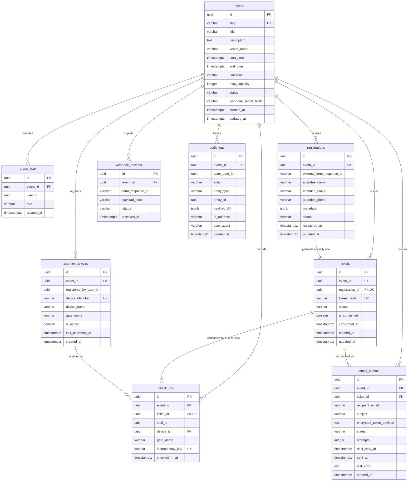

# EventFlow — Database Design Specification

**Phase**: Phase 1: Product Discovery & System Architecture  
**Document**: Database Design Document  
**Version**: 1.0.0  
**Target Engine**: PostgreSQL 17 (Supabase `ap-south-1` Mumbai)  
**Status**: APPROVED

---

## 1. Database Architecture & Connection Topology

EventFlow utilizes Supabase PostgreSQL 17 located in `ap-south-1` (Mumbai, India). 

### Connection Strategy
- **Application Runtime (FastAPI & Background Worker)**:
  - Connects to Supavisor Transaction Pooler (`aws-1-ap-south-1.pooler.supabase.com:6543`) via `postgresql+asyncpg://`.
  - Transaction pooling optimizes high-concurrency short-lived transactions (such as door check-in bursts).
- **Database Migrations (Alembic)**:
  - Connects to the direct PostgreSQL host (`db.jkchyjghuaiyulxqzobl.supabase.co:5432`) in session mode.
  - Required for transactional DDL operations, index builds, and schema state management.
- **Rules on DDL Operations**:
  - `SQLAlchemy.metadata.create_all()` is strictly forbidden in application code.
  - All migrations must be tracked in `backend/alembic/versions/`.

---

## 2. Entity-Relationship (ER) Diagram



---

## 3. Detailed Table Specifications

### 3.1 `events`
Represents an event managed on the platform.
- **Columns**:
  - `id`: `UUID PRIMARY KEY DEFAULT gen_random_uuid()`
  - `slug`: `VARCHAR(128) NOT NULL UNIQUE` (URL-safe slug for public event routing)
  - `title`: `VARCHAR(256) NOT NULL`
  - `description`: `TEXT NULL`
  - `venue_name`: `VARCHAR(256) NOT NULL`
  - `start_time`: `TIMESTAMPTZ NOT NULL`
  - `end_time`: `TIMESTAMPTZ NOT NULL`
  - `timezone`: `VARCHAR(64) NOT NULL DEFAULT 'Asia/Kolkata'`
  - `max_capacity`: `INTEGER NULL` (NULL = unlimited)
  - `status`: `VARCHAR(32) NOT NULL DEFAULT 'DRAFT'` (`DRAFT`, `PUBLISHED`, `ACTIVE`, `COMPLETED`, `ARCHIVED`)
  - `webhook_secret_hash`: `VARCHAR(128) NOT NULL` (Salted hash of HMAC secret for Google Apps Script verification)
  - `created_at`: `TIMESTAMPTZ NOT NULL DEFAULT NOW()`
  - `updated_at`: `TIMESTAMPTZ NOT NULL DEFAULT NOW()`
- **Indexes**:
  - `ix_events_slug` ON `events (slug)` (Unique B-tree)
  - `ix_events_status` ON `events (status)`
- **Deletion Policy**: Restrict deletion if confirmed registrations or tickets exist.

### 3.2 `event_staff`
Maps users (from Supabase Auth `auth.users`) to event roles.
- **Columns**:
  - `id`: `UUID PRIMARY KEY DEFAULT gen_random_uuid()`
  - `event_id`: `UUID NOT NULL REFERENCES events(id) ON DELETE CASCADE`
  - `user_id`: `UUID NOT NULL` (references Supabase Auth `auth.users.id`)
  - `role`: `VARCHAR(32) NOT NULL` (`owner`, `admin`, `staff`, `viewer`)
  - `created_at`: `TIMESTAMPTZ NOT NULL DEFAULT NOW()`
- **Constraints**:
  - `UNIQUE (event_id, user_id)` (A user has exactly one primary role per event)
- **Indexes**:
  - `ix_event_staff_user_event` ON `event_staff (user_id, event_id)` (Optimizes RBAC dependency checks)
- **Deletion Policy**: `ON DELETE CASCADE` when the parent event is deleted.

### 3.3 `registrations`
Stores attendee RSVP submissions.
- **Columns**:
  - `id`: `UUID PRIMARY KEY DEFAULT gen_random_uuid()`
  - `event_id`: `UUID NOT NULL REFERENCES events(id) ON DELETE RESTRICT`
  - `external_form_response_id`: `VARCHAR(128) NOT NULL` (Google Forms `FormResponse.getId()`)
  - `attendee_name`: `VARCHAR(256) NOT NULL`
  - `attendee_email`: `VARCHAR(256) NOT NULL`
  - `attendee_phone`: `VARCHAR(64) NULL`
  - `metadata`: `JSONB NOT NULL DEFAULT '{}'::jsonb` (Custom form question responses)
  - `status`: `VARCHAR(32) NOT NULL DEFAULT 'CONFIRMED'` (`PENDING`, `CONFIRMED`, `CANCELLED`)
  - `registered_at`: `TIMESTAMPTZ NOT NULL DEFAULT NOW()`
  - `updated_at`: `TIMESTAMPTZ NOT NULL DEFAULT NOW()`
- **Constraints**:
  - `UNIQUE (event_id, external_form_response_id)` (Guarantees form submission idempotency)
  - `UNIQUE (event_id, attendee_email)` WHERE `status != 'CANCELLED'` (Enforces one attendee per event)
- **Indexes**:
  - `ix_registrations_event_email` ON `registrations (event_id, attendee_email)`
  - `ix_registrations_status` ON `registrations (event_id, status)`
- **Deletion Policy**: `ON DELETE RESTRICT` to protect audit records.

### 3.4 `tickets`
Stores cryptographic ticket records.
- **Columns**:
  - `id`: `UUID PRIMARY KEY DEFAULT gen_random_uuid()`
  - `event_id`: `UUID NOT NULL REFERENCES events(id) ON DELETE RESTRICT`
  - `registration_id`: `UUID NOT NULL UNIQUE REFERENCES registrations(id) ON DELETE RESTRICT`
  - `token_hash`: `VARCHAR(64) NOT NULL UNIQUE` (SHA-256 hex digest of the 256-bit raw token)
  - `status`: `VARCHAR(32) NOT NULL DEFAULT 'ACTIVE'` (`ACTIVE`, `REVOKED`)
  - `is_consumed`: `BOOLEAN NOT NULL DEFAULT FALSE`
  - `consumed_at`: `TIMESTAMPTZ NULL`
  - `created_at`: `TIMESTAMPTZ NOT NULL DEFAULT NOW()`
  - `updated_at`: `TIMESTAMPTZ NOT NULL DEFAULT NOW()`
- **Constraints**:
  - `UNIQUE (token_hash)`
  - `UNIQUE (registration_id)` (Exactly 1 ticket per registration)
- **Indexes**:
  - `ix_tickets_token_hash` ON `tickets (token_hash)` (Fast scan lookup)
  - `ix_tickets_event_status` ON `tickets (event_id, status, is_consumed)`
- **Deletion Policy**: `ON DELETE RESTRICT`.

### 3.5 `check_ins`
Atomic event admission records.
- **Columns**:
  - `id`: `UUID PRIMARY KEY DEFAULT gen_random_uuid()`
  - `event_id`: `UUID NOT NULL REFERENCES events(id) ON DELETE RESTRICT`
  - `ticket_id`: `UUID NOT NULL UNIQUE REFERENCES tickets(id) ON DELETE RESTRICT`
  - `staff_id`: `UUID NOT NULL` (Staff user who validated the ticket)
  - `device_id`: `UUID NULL REFERENCES scanner_devices(id) ON DELETE SET NULL`
  - `gate_name`: `VARCHAR(128) NOT NULL DEFAULT 'Main Entrance'`
  - `idempotency_key`: `VARCHAR(128) NOT NULL UNIQUE` (Client-generated UUID to tolerate network retries)
  - `checked_in_at`: `TIMESTAMPTZ NOT NULL DEFAULT NOW()`
- **Constraints**:
  - `UNIQUE (ticket_id)` (PHYSICALLY PREVENTS DOUBLE CHECK-IN AT DATABASE LEVEL)
  - `UNIQUE (idempotency_key)`
- **Indexes**:
  - `ix_checkins_event_time` ON `check_ins (event_id, checked_in_at)` (Time-series throughput queries)
  - `ix_checkins_staff` ON `check_ins (staff_id)`

### 3.6 `webhook_receipts`
Tracks raw webhook ingestion for replay prevention and idempotency.
- **Columns**:
  - `id`: `UUID PRIMARY KEY DEFAULT gen_random_uuid()`
  - `event_id`: `UUID NOT NULL REFERENCES events(id) ON DELETE CASCADE`
  - `form_response_id`: `VARCHAR(128) NOT NULL`
  - `payload_hash`: `VARCHAR(64) NOT NULL` (SHA-256 of raw request payload)
  - `status`: `VARCHAR(32) NOT NULL DEFAULT 'PROCESSED'` (`PROCESSED`, `DUPLICATE`, `FAILED`)
  - `received_at`: `TIMESTAMPTZ NOT NULL DEFAULT NOW()`
- **Constraints**:
  - `UNIQUE (event_id, form_response_id)`
- **Indexes**:
  - `ix_webhook_receipts_lookup` ON `webhook_receipts (event_id, form_response_id)`

### 3.7 `email_outbox`
Transactional outbox pattern for reliable asynchronous email delivery.
- **Columns**:
  - `id`: `UUID PRIMARY KEY DEFAULT gen_random_uuid()`
  - `event_id`: `UUID NOT NULL REFERENCES events(id) ON DELETE CASCADE`
  - `ticket_id`: `UUID NOT NULL REFERENCES tickets(id) ON DELETE CASCADE`
  - `recipient_email`: `VARCHAR(256) NOT NULL`
  - `subject`: `VARCHAR(256) NOT NULL`
  - `encrypted_token_payload`: `TEXT NULL` (AES-256-GCM encrypted raw token; wiped after delivery)
  - `status`: `VARCHAR(32) NOT NULL DEFAULT 'PENDING'` (`PENDING`, `PROCESSING`, `SENT`, `RETRY`, `DEAD_LETTER`)
  - `attempts`: `INTEGER NOT NULL DEFAULT 0`
  - `next_retry_at`: `TIMESTAMPTZ NOT NULL DEFAULT NOW()`
  - `sent_at`: `TIMESTAMPTZ NULL`
  - `last_error`: `TEXT NULL`
  - `created_at`: `TIMESTAMPTZ NOT NULL DEFAULT NOW()`
- **Indexes**:
  - `ix_email_outbox_queue` ON `email_outbox (status, next_retry_at)` WHERE `status IN ('PENDING', 'RETRY')` (Optimizes polling worker queries)

### 3.8 `scanner_devices`
Registers authorized scanner hardware / browser devices.
- **Columns**:
  - `id`: `UUID PRIMARY KEY DEFAULT gen_random_uuid()`
  - `event_id`: `UUID NOT NULL REFERENCES events(id) ON DELETE CASCADE`
  - `registered_by_user_id`: `UUID NOT NULL`
  - `device_identifier`: `VARCHAR(128) NOT NULL UNIQUE` (Hardware / browser-fingerprint UUID)
  - `device_name`: `VARCHAR(128) NOT NULL`
  - `gate_name`: `VARCHAR(128) NOT NULL DEFAULT 'Main Gate'`
  - `is_active`: `BOOLEAN NOT NULL DEFAULT TRUE`
  - `last_heartbeat_at`: `TIMESTAMPTZ NOT NULL DEFAULT NOW()`
  - `created_at`: `TIMESTAMPTZ NOT NULL DEFAULT NOW()`
- **Indexes**:
  - `ix_scanner_devices_event` ON `scanner_devices (event_id, is_active)`

### 3.9 `audit_logs`
Immutable audit trail for compliance and security auditing.
- **Columns**:
  - `id`: `UUID PRIMARY KEY DEFAULT gen_random_uuid()`
  - `event_id`: `UUID NULL REFERENCES events(id) ON DELETE SET NULL`
  - `actor_user_id`: `UUID NULL` (User who performed action, or NULL for system actions)
  - `action`: `VARCHAR(64) NOT NULL` (`EVENT_CREATED`, `STAFF_ADDED`, `TICKET_REVOKED`, `CHECKIN_MANUAL_OVERRIDE`, etc.)
  - `entity_type`: `VARCHAR(64) NOT NULL` (`event`, `staff`, `ticket`, `registration`)
  - `entity_id`: `UUID NULL`
  - `payload_diff`: `JSONB NULL`
  - `ip_address`: `VARCHAR(45) NULL`
  - `user_agent`: `VARCHAR(256) NULL`
  - `created_at`: `TIMESTAMPTZ NOT NULL DEFAULT NOW()`
- **Indexes**:
  - `ix_audit_logs_event_created` ON `audit_logs (event_id, created_at DESC)`
  - `ix_audit_logs_actor` ON `audit_logs (actor_user_id)`

---

## 4. Concurrency & Atomicity Protocol

To ensure ticket consumption is atomic and race-condition free:

```sql
-- Executed inside a single PostgreSQL transaction
BEGIN;

-- 1. Exclusively lock the ticket row by its SHA-256 hash
SELECT id, event_id, status, is_consumed
FROM tickets
WHERE token_hash = :token_hash AND event_id = :event_id
FOR UPDATE;

-- 2. Verify business invariant in Python / SQL
-- If status != 'ACTIVE' -> ROLLBACK; return 400
-- If is_consumed == TRUE -> ROLLBACK; return 409

-- 3. Insert into check_ins table (guaranteed unique by UNIQUE (ticket_id))
INSERT INTO check_ins (
    id, event_id, ticket_id, staff_id, device_id, gate_name, idempotency_key, checked_in_at
) VALUES (
    gen_random_uuid(), :event_id, :ticket_id, :staff_id, :device_id, :gate_name, :idempotency_key, NOW()
);

-- 4. Mark ticket consumed
UPDATE tickets
SET is_consumed = TRUE, consumed_at = NOW(), updated_at = NOW()
WHERE id = :ticket_id;

COMMIT;
```
